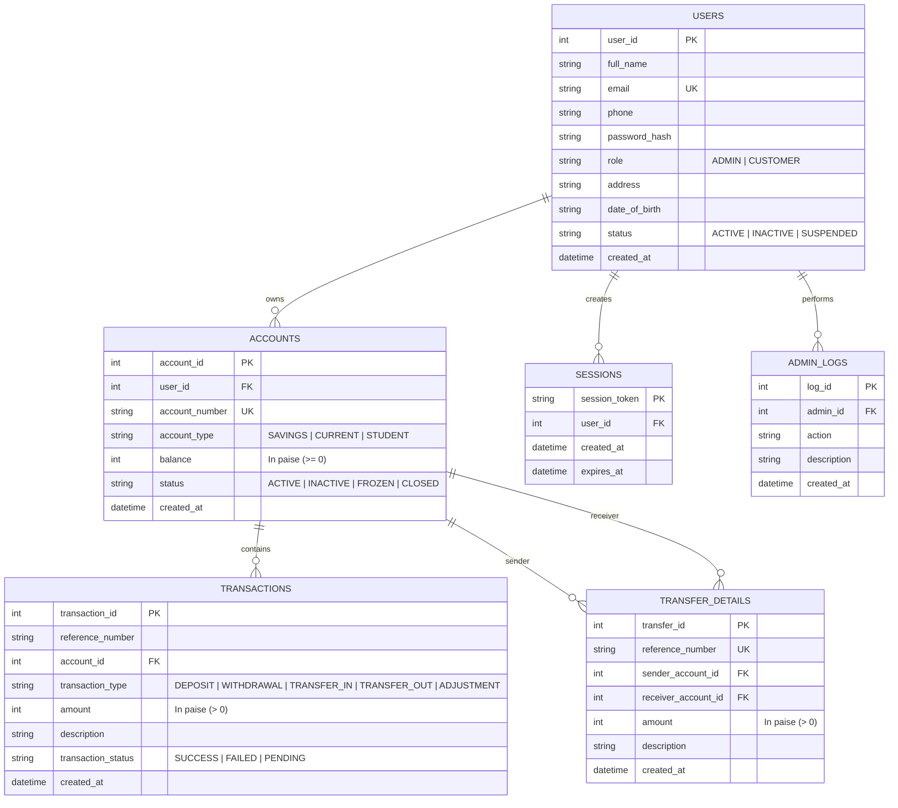

# Database Design Document: Bank Management System

## 1. Overview
The **Bank Management System** utilizes **SQLite3** as its relational database engine. All financial values are stored in integer **paise** (1 INR = 100 paise) rather than floating-point data types (`FLOAT` or `DOUBLE`). This eliminates binary rounding errors inherent in IEEE 754 representations and ensures exact monetary precision.

---

## 2. Relational Schema & Entity-Relationship Model



---

## 3. Detailed Table Specifications

### TABLE 1: `users`
| Column Name | Data Type | Constraints | Description |
| :--- | :--- | :--- | :--- |
| `user_id` | `INTEGER` | `PRIMARY KEY AUTOINCREMENT` | Unique identifier for each user |
| `full_name` | `TEXT` | `NOT NULL` | Customer or Administrator full legal name |
| `email` | `TEXT` | `UNIQUE NOT NULL` | Unique user email address (login credential) |
| `phone` | `TEXT` | - | Contact phone number |
| `password_hash`| `TEXT` | `NOT NULL` | Cryptographic hash: `salt$pbkdf2_hmac_sha256` |
| `role` | `TEXT` | `NOT NULL CHECK(role IN ('ADMIN', 'CUSTOMER'))` | User security role |
| `address` | `TEXT` | - | Customer residential postal address |
| `date_of_birth`| `TEXT` | - | Customer birth date (YYYY-MM-DD) |
| `status` | `TEXT` | `DEFAULT 'ACTIVE' CHECK(status IN ('ACTIVE','INACTIVE','SUSPENDED'))`| Account access flag |
| `created_at` | `DATETIME`| `DEFAULT CURRENT_TIMESTAMP` | Account registration timestamp |

---

### TABLE 2: `accounts`
| Column Name | Data Type | Constraints | Description |
| :--- | :--- | :--- | :--- |
| `account_id` | `INTEGER` | `PRIMARY KEY AUTOINCREMENT` | Internal account primary key |
| `user_id` | `INTEGER` | `NOT NULL, FK -> users(user_id) ON DELETE CASCADE` | Account holder |
| `account_number` | `TEXT` | `UNIQUE NOT NULL` | Unique bank account number (e.g. `ACC10010001`) |
| `account_type` | `TEXT` | `CHECK(account_type IN ('SAVINGS','CURRENT','STUDENT'))` | Financial account product type |
| `balance` | `INTEGER` | `NOT NULL DEFAULT 0 CHECK(balance >= 0)` | Available balance in integer paise (₹1 = 100 paise) |
| `status` | `TEXT` | `DEFAULT 'ACTIVE' CHECK(status IN ('ACTIVE','INACTIVE','FROZEN','CLOSED'))` | Account lifecycle state |
| `created_at` | `DATETIME`| `DEFAULT CURRENT_TIMESTAMP` | Account opening timestamp |

---

### TABLE 3: `transactions`
| Column Name | Data Type | Constraints | Description |
| :--- | :--- | :--- | :--- |
| `transaction_id` | `INTEGER` | `PRIMARY KEY AUTOINCREMENT` | Transaction identifier |
| `reference_number` | `TEXT` | `NOT NULL` | Unique transaction reference (e.g. `TXN179346...`) |
| `account_id` | `INTEGER` | `NOT NULL, FK -> accounts(account_id) ON DELETE CASCADE` | Associated bank account |
| `transaction_type` | `TEXT` | `CHECK(transaction_type IN ('DEPOSIT','WITHDRAWAL','TRANSFER_IN','TRANSFER_OUT','ADJUSTMENT'))` | Movement type |
| `amount` | `INTEGER` | `NOT NULL CHECK(amount > 0)` | Financial value in integer paise |
| `description` | `TEXT` | - | Memo / purpose note |
| `transaction_status` | `TEXT` | `DEFAULT 'SUCCESS' CHECK(transaction_status IN ('SUCCESS','FAILED','PENDING'))` | Execution status |
| `created_at` | `DATETIME`| `DEFAULT CURRENT_TIMESTAMP` | Transaction execution timestamp |

---

### TABLE 4: `transfer_details`
| Column Name | Data Type | Constraints | Description |
| :--- | :--- | :--- | :--- |
| `transfer_id` | `INTEGER` | `PRIMARY KEY AUTOINCREMENT` | Transfer primary key |
| `reference_number` | `TEXT` | `UNIQUE NOT NULL` | Cross-referenced transaction reference |
| `sender_account_id` | `INTEGER` | `NOT NULL, FK -> accounts(account_id)` | Source debit account |
| `receiver_account_id` | `INTEGER` | `NOT NULL, FK -> accounts(account_id)` | Destination credit account |
| `amount` | `INTEGER` | `NOT NULL CHECK(amount > 0)` | Transferred amount in paise |
| `description` | `TEXT` | - | Transfer memo |
| `created_at` | `DATETIME`| `DEFAULT CURRENT_TIMESTAMP` | Execution timestamp |

---

### TABLE 5: `admin_logs`
| Column Name | Data Type | Constraints | Description |
| :--- | :--- | :--- | :--- |
| `log_id` | `INTEGER` | `PRIMARY KEY AUTOINCREMENT` | Log identifier |
| `admin_id` | `INTEGER` | `NOT NULL, FK -> users(user_id)` | Administrator responsible |
| `action` | `TEXT` | `NOT NULL` | Operational event type |
| `description` | `TEXT` | - | Event details |
| `created_at` | `DATETIME`| `DEFAULT CURRENT_TIMESTAMP` | Audit timestamp |

---

### TABLE 6: `sessions`
| Column Name | Data Type | Constraints | Description |
| :--- | :--- | :--- | :--- |
| `session_token` | `TEXT` | `PRIMARY KEY` | Cryptographic random hex token (48 chars) |
| `user_id` | `INTEGER` | `NOT NULL, FK -> users(user_id) ON DELETE CASCADE` | Authenticated session user |
| `created_at` | `DATETIME`| `DEFAULT CURRENT_TIMESTAMP` | Login timestamp |
| `expires_at` | `DATETIME`| `NOT NULL` | Session expiry time (24 hours standard) |

---

## 4. Performance Indexes
Indexes are implemented to optimize retrieval times across large transaction volumes:
1. `idx_users_email` ON `users(email)`: Speeds up authentication lookup to $O(1)$.
2. `idx_accounts_account_number` ON `accounts(account_number)`: Enables instant beneficiary validation during transfers.
3. `idx_accounts_user_id` ON `accounts(user_id)`: Accelerates customer dashboard account retrieval.
4. `idx_transactions_account_id` ON `transactions(account_id)`: Optimizes account statement generation.
5. `idx_transactions_ref` ON `transactions(reference_number)`: Ensures rapid receipt lookups.
6. `idx_transactions_date` ON `transactions(created_at)`: Accelerates monthly and daily reporting.
7. `idx_sessions_token` ON `sessions(session_token)`: Ensures zero-overhead token authentication per API request.

---

## 5. ACID Guarantees & Transaction Integrity
All financial money transfers utilize SQLite transactions:
```sql
BEGIN IMMEDIATE TRANSACTION;
-- 1. Deduct funds from sender
UPDATE accounts SET balance = balance - :amount WHERE account_id = :sender_id AND balance >= :amount;
-- 2. Add funds to receiver
UPDATE accounts SET balance = balance + :amount WHERE account_id = :receiver_id;
-- 3. Record double-entry transactions
INSERT INTO transactions VALUES (..., 'TRANSFER_OUT', ...);
INSERT INTO transactions VALUES (..., 'TRANSFER_IN', ...);
-- 4. Record cross-account audit record
INSERT INTO transfer_details VALUES (...);
COMMIT;
```
If any error occurs, `ROLLBACK` is immediately invoked, preventing inconsistent balances or partial transfers.
