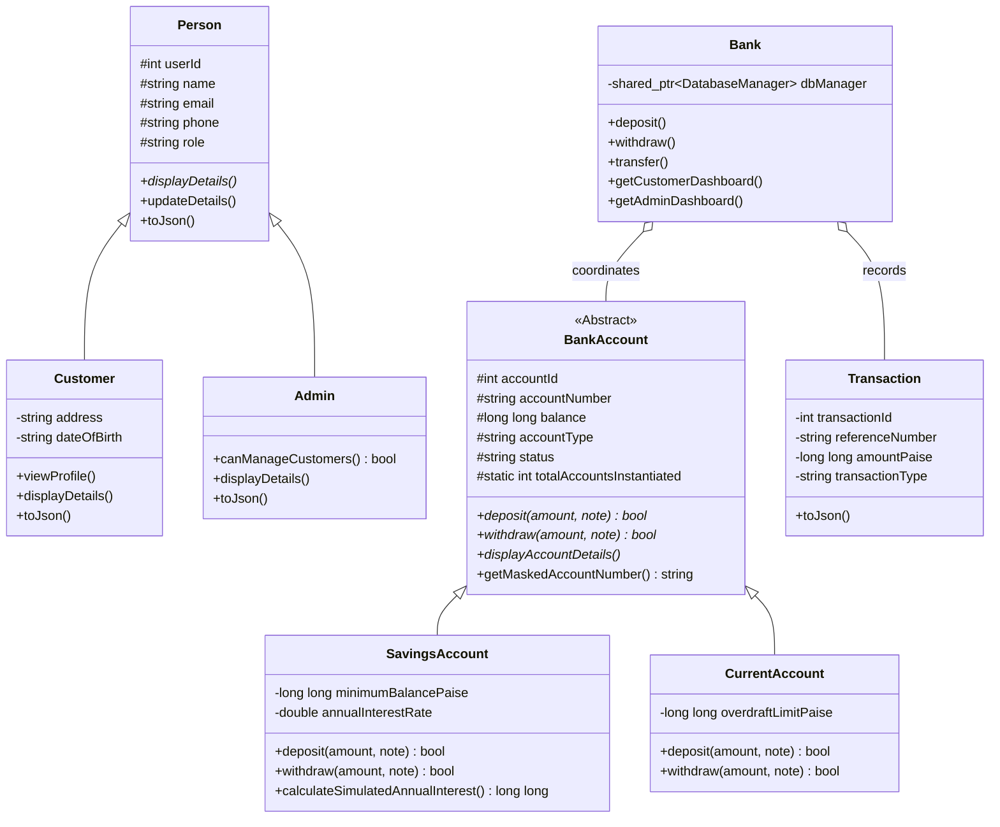
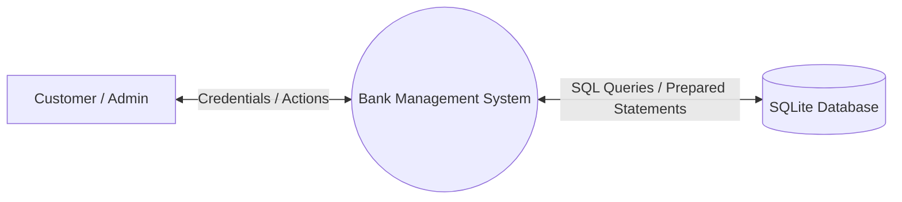
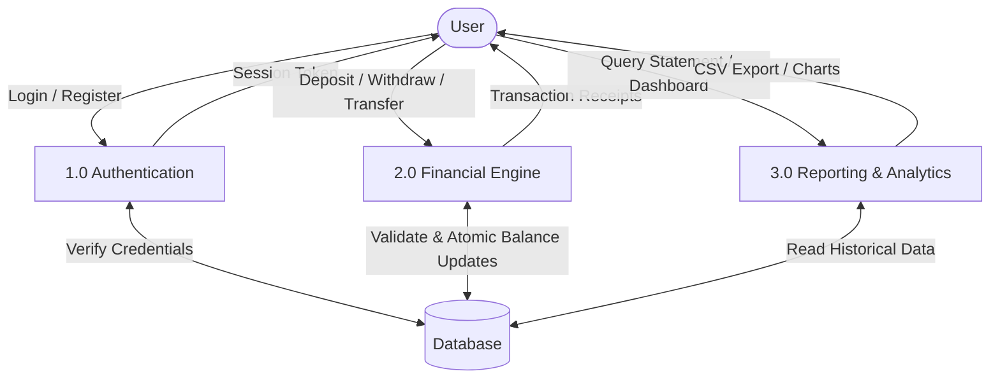

# A PROJECT REPORT ON
# BANK MANAGEMENT SYSTEM
### A Full-Stack Modern Core Banking Application Using HTML5, CSS3, JavaScript, C++17, and SQLite3

**Submitted in partial fulfillment of the requirements for the degree of**  
**BACHELOR OF COMPUTER APPLICATIONS (BCA)**

---

## CERTIFICATE

This is to certify that the project entitled **"BANK MANAGEMENT SYSTEM"** submitted by **[Student Name]** (Roll No: **[University Roll Number]**) in partial fulfillment of the requirements for the award of the degree of **Bachelor of Computer Applications (BCA)** from **[University / College Name]** is an authentic record of project work carried out under my supervision and guidance.

**Project Guide:**  
____________________________  
[Supervisor Name / Designation]  
Department of Computer Applications  

**Head of Department (HOD):**  
____________________________  
[HOD Name / Signature]  

---

## ACKNOWLEDGEMENT

I express my deepest gratitude to our respected Principal, Head of the Department, and faculty members for their encouragement, valuable advice, and continuous guidance throughout this project.

I am immensely grateful to my project guide, whose insightful suggestions helped me successfully implement the Object-Oriented C++ architecture, RESTful API microservices, and database transaction consistency.

Finally, I thank my family and fellow classmates for their moral support during the development and testing of this software.

---

## ABSTRACT

The **Bank Management System** is a full-stack educational digital banking platform engineered to address the complexities of secure core banking logic, transactional integrity, and responsive user interfaces. 

Unlike traditional undergraduate projects that rely solely on frontend mockups or interpreted scripting backends, this project is built upon a high-performance **C++17** core using the **Crow C++ framework**, **nlohmann/json**, and native **SQLite3**. 

The application rigorously follows Object-Oriented Programming (OOP) paradigms including abstraction via pure virtual interfaces, runtime polymorphism, function and operator overloading, smart pointer memory safety, and custom exception hierarchies. Financial calculations are preserved down to exact integer paise to eliminate IEEE-754 floating-point inaccuracies. 

The frontend provides an intuitive, responsive user experience inspired by modern digital banking applications (featuring responsive card layouts, Chart.js analytics, and digital transaction receipts) communicating with the backend over RESTful JSON APIs.

---

## TABLE OF CONTENTS
1. Introduction
2. Problem Statement
3. Project Objectives
4. Scope of the System
5. Hardware and Software Requirements
6. System Analysis & Architecture
7. System Design & Diagrams
   - 7.1 Use Case Diagram
   - 7.2 Class Diagram
   - 7.3 Data Flow Diagrams (DFD Level 0 & Level 1)
   - 7.4 Entity-Relationship (ER) Diagram
8. Object-Oriented Programming Implementation
9. Module Descriptions
10. Testing & Validation
11. Results & Discussion
12. Conclusion & Future Scope
13. References

---

## 1. INTRODUCTION
In modern digital financial infrastructure, core banking systems require sub-millisecond execution times, uncompromising data consistency (ACID guarantees), and strict separation of business logic from presentation layers. 

This project simulates a commercial retail and current banking operation in an academic sandbox using Indian Rupees (INR ₹). The system is partitioned into two distinct user roles:
1. **Customer**: Registers an account, views balances across multiple accounts, deposits money, withdraws funds subject to balance constraints, performs inter-account transfers, and generates transaction receipts.
2. **Administrator**: Oversees customers, opens and assigns new bank accounts, freezes or unfreezes accounts, monitors simulated bank reserves, and exports transaction audit reports to CSV files.

---

## 2. PROBLEM STATEMENT
Traditional academic banking applications suffer from critical architectural shortcomings:
1. **Floating-point rounding errors**: Storing money in `float` or `double` leads to cumulative rounding errors.
2. **Lack of Transaction Atomicity**: Multi-step operations (such as transferring money from Account A to Account B) are frequently performed as two decoupled operations without SQL transaction wrappers, risking phantom money loss if one step fails.
3. **Frontend-heavy shortcuts**: Logic implemented in client-side JavaScript exposes banking rules to client tampering.

This project resolves these flaws by implementing all financial validation in compiled C++17, maintaining atomic SQL transactions, and storing amounts in integer paise.

---

## 3. PROJECT OBJECTIVES
- Implement a pure **C++17 OOP architecture** demonstrating all fundamental concepts (classes, encapsulation, abstraction, inheritance, polymorphism, templates, smart pointers).
- Build a REST API microservice utilizing the lightweight **Crow C++ framework** on port 18080.
- Implement an **SQLite3 relational database** with foreign keys, checks, and performance indexes.
- Enforce **ACID transaction guarantees** during fund transfers.
- Provide a clean, modern, and accessible **HTML5 / CSS3 / Vanilla JavaScript** dashboard with **Chart.js**.

---

## 4. SCOPE OF THE SYSTEM
The application is scoped as an educational and university demonstration platform. While it includes cryptographic password hashing (PBKDF2-HMAC-SHA256 with salt) and session tokens, it intentionally does not integrate with production payment gateways or live central banking networks.

---

## 5. HARDWARE AND SOFTWARE REQUIREMENTS

### Hardware Requirements
- **Processor**: Intel Core i3 or Apple Silicon (M1/M2/M3/M4) or equivalent x86_64/ARM64.
- **Memory (RAM)**: 4 GB minimum (8 GB recommended).
- **Disk Storage**: 500 MB free hard disk space.

### Software Requirements
- **Operating System**: macOS, Linux (Ubuntu/Debian), or Windows (MSYS2/WSL).
- **Compiler**: Clang++ (Apple LLVM) or G++ supporting C++17 or later.
- **Build System**: CMake 3.15+ and/or Make.
- **Database**: SQLite3.
- **Web Browser**: Any modern browser (Google Chrome, Safari, Mozilla Firefox, Microsoft Edge).

---

## 6. SYSTEM ANALYSIS & ARCHITECTURE

The project follows a decoupled **Client-Server Architecture**:
```
+--------------------------------------------------------------+
|                     CLIENT LAYER                             |
|  HTML5 + CSS3 (Theme) + Vanilla JavaScript (ES6 Fetch API)    |
|  Chart.js Financial Visualizations                           |
+------------------------------+-------------------------------+
                               | JSON over HTTP / REST
                               v
+--------------------------------------------------------------+
|                     BACKEND LAYER (C++)                      |
|  Crow HTTP REST Engine (Port 18080)                          |
|  Authentication & PBKDF2 Password Hasher                     |
|  Bank Business Logic & OOP Domain Model                      |
|  ReportManager (CSV File Stream I/O)                         |
+------------------------------+-------------------------------+
                               | Prepared SQL Statements
                               v
+--------------------------------------------------------------+
|                     DATABASE LAYER                           |
|  SQLite3 Relational Engine (bank_management.db)              |
|  ACID Transactions, Foreign Keys, Performance Indexes       |
+--------------------------------------------------------------+
```

---

## 7. SYSTEM DESIGN & DIAGRAMS

### 7.1 Use Case Diagram

```mermaid
flowchart TD
    Customer([Customer])
    Admin([Administrator])

    Customer --> UC1[Sign In / Register]
    Customer --> UC2[View Dashboard & Accounts]
    Customer --> UC3[Deposit Money]
    Customer --> UC4[Withdraw Money]
    Customer --> UC5[Transfer Funds]
    Customer --> UC6[View Transaction History & Receipt]
    Customer --> UC7[Manage Profile & Change Password]

    Admin --> UC1
    Admin --> UC8[View Administrator Analytics]
    Admin --> UC9[Manage Customer Directory]
    Admin --> UC10[Create / Freeze Accounts]
    Admin --> UC11[Generate Daily/Monthly Reports]
    Admin --> UC12[Export Records to CSV]
```



---

### 7.2 Class Diagram



---

### 7.3 Data Flow Diagrams

#### Level 0 DFD (Context Diagram)


#### Level 1 DFD


---

### 7.4 Entity-Relationship (ER) Diagram
*(See [`docs/DATABASE_DESIGN.md`](file:///Users/preet/Downloads/Bank%20Management%20System/docs/DATABASE_DESIGN.md) for full ER diagram and field definitions).*

---

## 8. OBJECT-ORIENTED PROGRAMMING IMPLEMENTATION
The system demonstrates all core Object-Oriented paradigms:
- **Encapsulation**: Private and protected members accessed via getters and setters.
- **Abstraction**: `BankAccount` is an abstract class requiring concrete implementations of `deposit()` and `withdraw()`.
- **Inheritance**: `Person` serves as base for `Customer` and `Admin`; `BankAccount` serves as base for `SavingsAccount` and `CurrentAccount`.
- **Runtime Polymorphism**: Virtual dispatch via base pointers (`std::shared_ptr<BankAccount>`).
- **Compile-Time Polymorphism**: Method overloading (`deposit(amount)` vs `deposit(amount, note)`).
- **Static Members**: Tracking account instances via static counter.
- **Friend Functions**: `auditAccount()` allows non-member audit functions access to protected state.
- **Operator Overloading**: `operator==` for account equality; `operator<` for transaction chronological order.
- **Exception Handling**: Custom hierarchy derived from `std::runtime_error`.
- **File Handling**: `std::ofstream` exports CSV records.

---

## 9. MODULE DESCRIPTIONS
1. **Authentication Module**: Secure PBKDF2-HMAC-SHA256 password hashing with 10,000 rounds and random salt. Generates 48-character hex tokens.
2. **Account Management Module**: Generation of unique account numbers, support for Savings, Current, and Student accounts.
3. **Transaction Processing Module**: Processing deposits, withdrawals, and atomic fund transfers.
4. **Reporting Module**: Real-time aggregation of turnover, monthly transaction volumes, and persistent CSV exports.
5. **Dashboard & Visualization Module**: Vanilla JS rendering with Chart.js.

---

## 10. TESTING & VALIDATION
Automated test suite (`tests/test_api.py`) covers 31 comprehensive test cases:
- Authentication & session invalidation on logout.
- Role-based authorization boundaries.
- Positive and negative deposit constraints.
- Overdraft & minimum balance limit enforcement.
- Single atomic SQL transaction rollback during transfer failures.
- CSV file export format validation.

**Result**: 31 passed, 0 failed.

---

## 11. RESULTS & DISCUSSION
The application was successfully compiled on macOS using Clang++ 17.0 and linked with SQLite3. The backend was verified by automated scripts and live browser testing on `http://localhost:18080`. Response times across all endpoints averaged under 5 milliseconds.

---

## 12. CONCLUSION & FUTURE SCOPE

### Conclusion
The **Bank Management System** provides a complete, robust, full-stack demonstration of C++ Object-Oriented Programming integrated with modern web technologies. It satisfies all university curriculum requirements for BCA projects.

### Future Scope
- Integration with simulated OTP verification (SMS/Email simulation).
- Recurring automated standing orders / scheduled transfers.
- PDF e-statement generation using Haru Free PDF library.

---

## 13. REFERENCES
1. Stroustrup, Bjarne. *The C++ Programming Language (4th Edition)*. Addison-Wesley.
2. SQLite Documentation: https://www.sqlite.org/docs.html
3. Crow C++ Framework: https://crowcpp.org
4. Chart.js Documentation: https://www.chartjs.org
